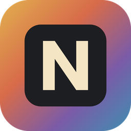

<p align="center"></p>

<h1 align="center">Nousara Image</h1>

<p align="center">A native, Photoshop-style image editor for Windows: layers, masks, adjustment layers, layer styles, type, vectors, brushes and PSD files.</p>

## Based on PhotoCraft

Nousara Image is built from [PhotoCraft](https://github.com/storytold/photocraft), the open-source
image editor by the ArtCraft Team and the PhotoCraft contributors, under the MIT and Apache 2.0
licenses. See [`NOTICE`](NOTICE) for what changed and [`docs/PHOTOCRAFT-README.md`](docs/PHOTOCRAFT-README.md)
for PhotoCraft's own documentation (features, architecture, building). Nousara Image is not made
or endorsed by the ArtCraft Team.

## Install on Windows

Download `Nousara-Image-Setup-<version>.exe` from the releases and run it. It installs for the
current user (no administrator rights) and adds Start Menu and desktop shortcuts. The installer is
not code-signed yet, so Windows SmartScreen asks first: choose **More info**, then **Run anyway**.

## Build the Windows installer from Linux

```sh
sudo apt-get install mingw-w64 nsis
rustup target add x86_64-pc-windows-gnu
CRAFT_FONTS_DIR=../craft-fonts packaging/nousara/build-windows.sh   # writes dist/Nousara-Image-Setup-<version>.exe
```

## License

MIT OR Apache-2.0, like PhotoCraft. See [`LICENSE-MIT`](LICENSE-MIT), [`LICENSE-APACHE`](LICENSE-APACHE)
and [`NOTICE`](NOTICE).
